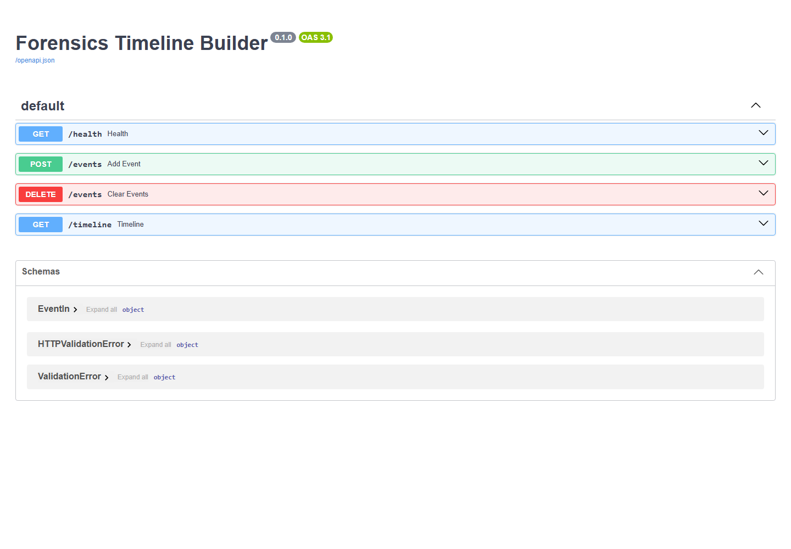

# Digital Forensics Timeline Builder

A local-first API for collecting curated forensic events and assembling them into a chronological, filterable incident timeline. Each event keeps its source and artifact metadata attached.



## Features

- Validates timezone-aware event timestamps and normalizes them to UTC.
- Retains host, source, actor, artifact, SHA-256, and structured details.
- Returns a chronological timeline with optional host and source filters.
- Includes interactive OpenAPI documentation at `/docs`.

## Run on Windows

```powershell
.\.venv\Scripts\python.exe -m uvicorn app.main:app --host 127.0.0.1 --port 8002 --reload
```

Then open <http://127.0.0.1:8002/docs>.

## API

- `GET /health` — service status and event count
- `POST /events` — add a validated event
- `GET /timeline?host=LAB-PC-01&source=windows-security-log` — sorted timeline
- `DELETE /events` — clear the in-memory case data

Example event:

```json
{
  "timestamp": "2026-11-08T09:42:00Z",
  "source": "windows-security-log",
  "host": "LAB-PC-01",
  "event_type": "account_login_failure",
  "summary": "Failed interactive login",
  "actor": "lab-user",
  "artifact": "Security.evtx",
  "details": {"event_id": 4625}
}
```

The sample records are in `data/sample-events.json`. Submit them individually to `POST /events` to populate a demo timeline.

## VS Code

Open the folder in VS Code and select **Forensics Timeline API** in **Run and Debug**. The configuration uses this folder's virtual environment and port 8002.

## Data handling

This starter stores records in memory and clears them when the process restarts. Use only authorized lab evidence. Preserve original evidence and document collection times before adapting the project for real investigations.

