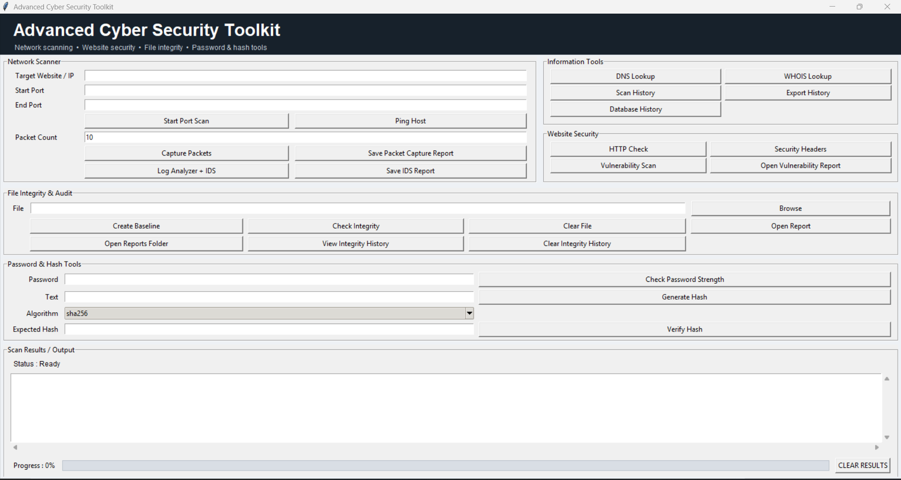
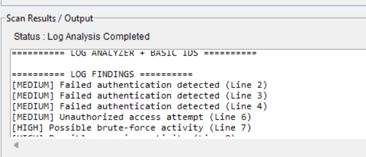
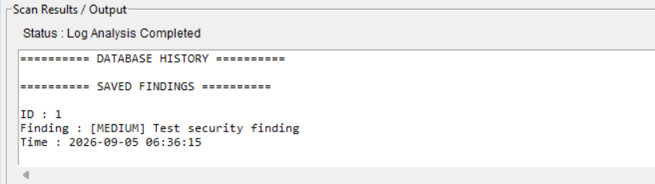
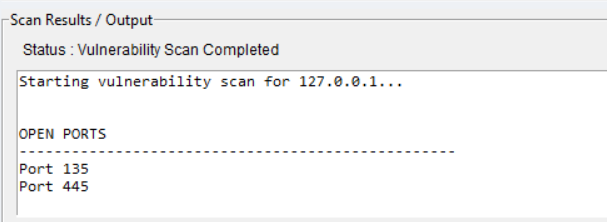

# Advanced Cyber Security Toolkit

A Python-based cybersecurity toolkit with a graphical user interface (GUI) for performing authorized security analysis and monitoring tasks.

## Features

- Port Scanner
- Ping Scanner
- DNS Lookup
- WHOIS Lookup
- HTTP Security Checker
- Security Headers Checker
- File Integrity Checker
- Password Strength Checker
- Hash Generator and Verification
- Packet Sniffer
- Vulnerability Scanner
- Log Analyzer
- Basic Intrusion Detection System (IDS)
- SQLite Database
- Security Reports

## Mini-SOC Workbench

An offline-first SOC lab with incident triage, configurable detection rules, Wazuh alert JSONL import, and a local dashboard. [Open the project](Mini_SOC_Workbench/README.md).

## Installation

### 1. Clone the Repository

```bash
git clone <YOUR_GITHUB_REPOSITORY_URL>
cd PortScanner
python -m pip install -r requirements.txt
python gui.py

Requirements

Python 3.x
Windows / Linux / macOS
Requests
Tkinter
SQLite3

## Usage

Launch the graphical interface:

```bash
python gui.py

Network Scanning

Enter an authorized target and port range, then use:

Start Port Scan
Ping Host
Packet Sniffing

Enter the packet count and select:

Capture Packets
Save Packet Capture Report
Log Analysis and IDS

Use:

Log Analyzer + IDS
Save IDS Report
Database History
Website Security

Use:

HTTP Check
Security Headers
Vulnerability Scan
Open Vulnerability Report
File Integrity

Select a file and use:

Create Baseline
Check Integrity
View Integrity History
Password and Hash Tools

Use:

Check Password Strength
Generate Hash
Verify Hash

## Project Structure

```text
PortScanner/
│
├── gui.py
├── database.py
├── scanner.py
├── ping_scanner.py
├── packet_sniffer.py
├── vulnerability_scanner.py
├── log_analyzer.py
├── ids.py
│
├── dns_lookup.py
├── dns_report.py
├── dns_csv_report.py
│
├── whois_lookup.py
├── whois_report.py
├── whois_csv_report.py
│
├── http_checker.py
├── security_report.py
│
├── file_integrity.py
├── password_hash.py
├── services.py
│
├── requirements.txt
├── README.md
└── .gitignore
```

gui.py
   ↓
Main GUI

scanner.py
ping_scanner.py
packet_sniffer.py
   ↓
Network tools

log_analyzer.py
ids.py
   ↓
Security monitoring

database.py
   ↓
SQLite database

## Security & Disclaimer

This toolkit is developed for educational purposes and authorized security testing.

### Responsible Use

- Use the toolkit only on systems and networks you own or have permission to test.
- Do not scan or analyze unauthorized systems.
- Do not use the toolkit for malicious activities.
- Keep sensitive information, credentials, tokens, and private data out of reports and GitHub repositories.
- Review generated reports before sharing them publicly.

The developer is not responsible for misuse of this toolkit.

## Screenshots

### Main GUI



### Log Analyzer and IDS



### Database History



### Vulnerability Scanner



## AI Malware Analyzer Project Report

A separate educational Windows desktop project for static PE file inspection, hash calculation, indicator checks, an experimental Random Forest result, and saved text reports. It does not execute files or provide runtime behavior analysis. Its small-sample model metrics are educational only.

Read the [AI Malware Analyzer project report](AI_Malware_Analyzer/PROJECT_REPORT.md) for the design, feature flow, test evidence, setup summary, and limitations.
